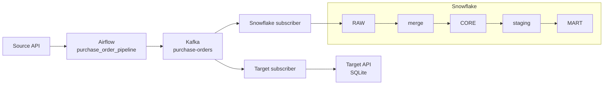
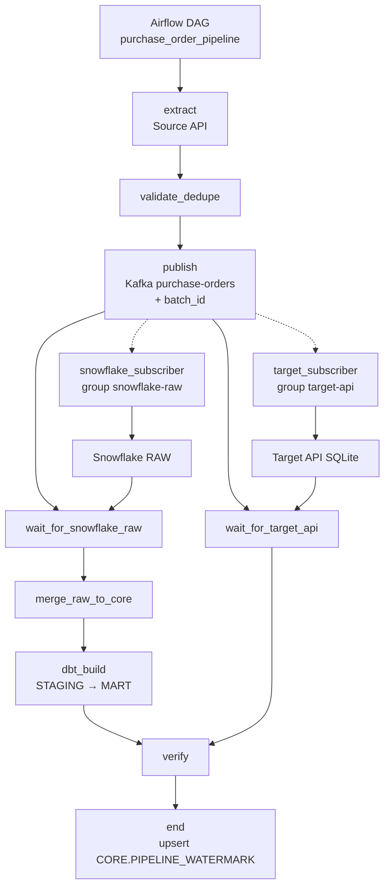
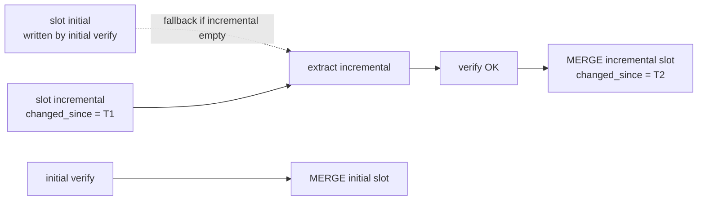
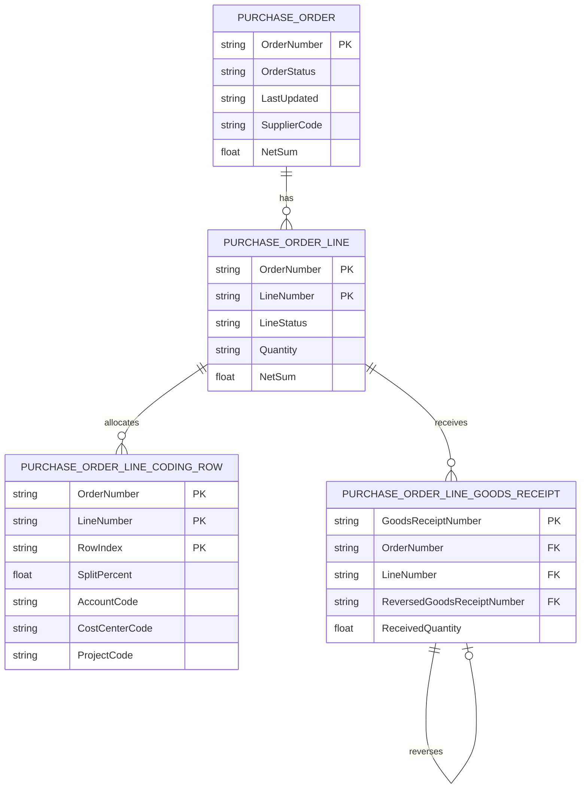
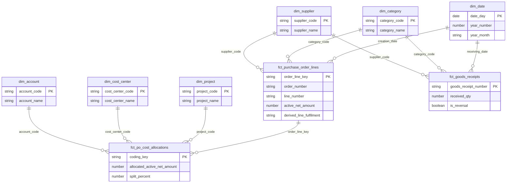

# 🛒 Purchase Order Data Pipeline

Personal technical exercise: synthetic purchase orders from a file-backed **source API** through **Kafka** to a **target API** (SQLite) and **Snowflake** (RAW → CORE → staging → MART), orchestrated by one Airflow DAG.

## 🏗️ Architecture



| Layer | What it holds |
| --- | --- |
| 📥 **RAW** | One Kafka message = one `VARIANT` PO document |
| 🧱 **CORE** | Four ER tables (merge from RAW) + `PIPELINE_WATERMARK` |
| 🔧 **staging** | dbt views — rename, cast, keys |
| 📊 **MART** | 6 dimensions + 3 facts |

Detailed design notes (local only): [`docs/data-analysis.md`](docs/data-analysis.md).

---

## 🧩 Components

| Piece | Port / path | Notes |
| --- | --- | --- |
| Source API | `:8000` | `GET /purchase-orders` (`load_type`, `changed_since`), `/health` |
| Kafka (KRaft) | UI `:8080` | Topics `purchase-orders` (3 partitions), `purchase-orders-failed` |
| Target API | `:8001` | SQLite upsert + `LastUpdated` guard · **200** created/updated · **409** older version rejected |
| Target subscriber | group `target-api` | PUT → commit on **2xx** or **409** |
| Snowflake subscriber | group `snowflake-raw` | Lands in `RAW.PURCHASE_ORDER_PAYLOADS` (host process; key-pair via `.env`) |
| Airflow | `:8081` (`admin`/`admin`) | DAG `purchase_order_pipeline` |
| SQL | `airflow/dags/sql/` | DDL + RAW→CORE merge |
| dbt | `airflow/dags/dbt/` | Staging → MART; unique/not-null/relationships + splits=100 + category=cost-centre |
| Streamlit | `scripts/snowflake_streamlit_app.py` | Snowsight app over `MART` (supplier, cost centre, fulfilment, line filters) |
| Tests / CI | `tests/`, `airflow/dags/tests/` | ruff, pytest, `dbt parse`, sqlfluff, gitleaks |
| Smoke | `scripts/publish_initial.py` | Pre-Airflow publish check |
| Kubernetes | `kubernetes/` | minikube + Kustomize; `./scripts/kubernetes_create_secrets.sh` |
| Local gate | `./scripts/test.sh` | ruff + pytest + dbt parse + sqlfluff |

### 🌀 Airflow DAG

#### Pipeline run



#### Watermark cycle

One row per `load_type` (PK `pipeline_name, load_type`). Manual triggers today; later you can schedule initial daily / incremental hourly against the same slots.



| Detail | Value |
| --- | --- |
| Param `load_type` | `initial` \| `incremental` (incremental always hits the incremental file; watermark adds `changed_since`) |
| Watermark | Snowflake `CORE.PIPELINE_WATERMARK` — two slots; `verify` upserts only this run’s `load_type` |
| Logs | Full order payloads omitted (`show_return_value_in_logs=False`) |

---

## 📐 Data modelling

### 🧩 From these issues to the model we built

The extract is consistent enough to model, and inconsistent enough that a straight flatten-and-insert is wrong. The pipeline and MART answer each trap once, at the right layer:

| Finding | What goes wrong if you ignore it | How we solve it |
| --- | --- | --- |
| Duplicate `PO1040078`, later array row is older | Last-in-file / string-sort “wins” and you drop `GR700192` | Airflow `validate_dedupe` + merge: parse `LastUpdated` with offset → UTC; keep **newest** per `OrderNumber` |
| Mix of `Z` and `+10:00` timestamps | Same instant compared as different strings | Store / compare as `TIMESTAMP_TZ` (`TO_TIMESTAMP_TZ` at ingest and in merge) |
| Header net ≠ sum of all lines (cancelled keep amounts) | Reporting “order total” double-counts or invents money | CORE stores amounts **as sent**; MART `active_net_amount` / `cancelled_net_amount` on the **line** fact |
| `Quantity` / `LineNumber` / `RowIndex` as text; receipt qty int vs float | Bad maths or silent cast loss | CORE keeps ER text types; **staging** casts for measures (`ordered_qty`, ints for sort) |
| Unchanged replay of `PO1040000` | PK clash or blind overwrite of a newer CORE row | Merge guard: apply only when incoming `LastUpdated` **≥** stored; equal = no-op |
| Reversal = new receipt with negative qty | Net received overstated if negatives dropped | CORE keeps every receipt + self-FK; fact `fct_goods_receipts` + `is_reversal`; net = **SUM** including negatives |
| Header `OrderStatus` ≠ line/receipt reality | “Received” / “Closed” used as truth for fulfilment | Store source status; derive `derived_line_fulfilment` on `fct_purchase_order_lines` |
| `LineNumber` / `RowIndex` only unique inside parent | Colliding keys across orders | Composite PKs on CORE; surrogate keys in staging (`order_line_key`, `coding_key`); GR number globally unique |
| Fan-out (coding 1–3 × receipts 0–4 on one line) | One wide join multiplies $ and qty | **Three facts** at three grains — see MART below |

### 🗄️ CORE model

Four ER tables after RAW→CORE merge. Full notes: `docs/data-analysis.md` §3.2.




### ⭐ MART / dbt model

Staging views over CORE, then six dimensions + three facts in `MART` (dbt under `airflow/dags/dbt/`).

**Why three facts:** a line can have several coding rows *and* several goods receipts. One flat join multiplies rows and double-counts money. Each measure lives at one grain:

| Fact | Grain | Question |
| --- | --- | --- |
| `fct_purchase_order_lines` | order + line | What was ordered / fulfilment? |
| `fct_po_cost_allocations` | order + line + coding row | Which account / cost centre / project? |
| `fct_goods_receipts` | goods receipt number | What arrived or was reversed? |

#### 🌟 Star schema



After both loads: Σ line `active_net_amount` = Σ allocation `allocated_active_net_amount` ≈ **703,170.63 AUD**.

---

## 🛠️ Setup (macOS)

```bash
cd purchase-order-data-pipeline
python3 -m venv .venv
source .venv/bin/activate
python -m pip install -r requirements.txt

# DAG tests need Airflow (same pin as Compose image):
python -m pip install "apache-airflow==3.3.2" "apache-airflow-providers-standard==1.19.0" \
  --constraint "https://raw.githubusercontent.com/apache/airflow/constraints-3.3.2/constraints-3.12.txt"

cp .env.example .env   # fill Snowflake + Fernet; keep rsa_key.p8 next to .env (gitignored)
./scripts/test.sh      # ruff + pytest + dbt parse + sqlfluff (same gate as CI)
```

Synthetic JSON lives under `data/`. Do not commit `.env` or `rsa_key.*`.

---

## 🚀 Run the stack

```bash
# repo root, venv on, .env + rsa_key.p8 present
docker compose up -d --build
# Airflow UI may take ~1 min on first boot (airflow-init migrates the DB).
# Jaeger + otel-collector are in the default stack (no profile).

# Snowflake subscriber on the host (Compose snowflake profile is awkward with the Mac key path)
# snowflake-subscriber starts with Compose (needs ./rsa_key.p8).
# Optional host fallback: python -m services.snowflake_subscriber.main
```

| Service | URL |
| --- | --- |
| Source API | http://127.0.0.1:8000/health · [docs](http://127.0.0.1:8000/docs) |
| Target API | http://127.0.0.1:8001/health · [docs](http://127.0.0.1:8001/docs) |
| Kafka UI | http://127.0.0.1:8080 |
| Airflow UI | http://127.0.0.1:8081 (`admin` / `admin`) |
| Jaeger UI | http://127.0.0.1:16686 |
| Kafka (host) | `127.0.0.1:9092` (prefer IPv4; `localhost` may hit IPv6 first) |
| Kafka (Compose) | `kafka:29092` |

### 💨 Smoke (without Airflow)

Quick check that source → Kafka → target works (stack up; host Snowflake subscriber optional here):

```bash
curl -s 'http://127.0.0.1:8000/purchase-orders?load_type=initial' \
  | python3 -c 'import json,sys; d=json.load(sys.stdin); print(d["load_type"], d["record_count"])'

python scripts/publish_initial.py

curl -s 'http://127.0.0.1:8001/purchase-orders' \
  | python3 -c 'import json,sys; print("total count:", json.load(sys.stdin)["count"])'
```

`changed_since` is strict greater-than on UTC `LastUpdated`. The source returns the file as-is (including duplicate versions); Airflow `validate_dedupe` keeps the newest per `OrderNumber`.

### ▶️ Airflow demo

1. Unpause `purchase_order_pipeline`.
2. Trigger with param `load_type=initial` → ~100 orders; CORE ≈ **100 / 215 / 275 / 181**.
3. Trigger again with `load_type=incremental` → ~18 after dedupe; CORE ≈ **104 / 224 / 286 / 189**.
4. Confirm `snowflake-subscriber` is up (`docker compose ps`) so `wait_for_snowflake_raw` can succeed.
5. After a green `verify`, check `SELECT * FROM CORE.PIPELINE_WATERMARK;` (two slots: `initial` / `incremental`).

### 📦 dbt

Host rebuild (optional; DAG task `dbt_build` already runs this in Airflow):

```bash
set -a && source .env && set +a
cd airflow/dags/dbt
dbt build --profiles-dir .
```

If the Airflow image was built before dbt was added, rebuild once:

```bash
docker compose build airflow-api-server airflow-scheduler airflow-dag-processor && docker compose up -d
```

### 📡 OpenTelemetry / Jaeger

One trace per `OrderNumber`: publish → Kafka (`traceparent` header) → target-subscriber → target-api.

Full walkthrough: `docs/opentelemetry.md`. Airflow **3.3.2** also exports native task spans (Jaeger service `airflow`, e.g. `po.wait.target_api`).

| Piece | URL |
| --- | --- |
| Jaeger UI | http://127.0.0.1:16686 |
| OTLP (host → collector) | `http://127.0.0.1:4318` |

With the stack already up from **Run the stack**:

```bash
# host publisher (venv)
export OTEL_SERVICE_NAME=po-publisher
export OTEL_EXPORTER_OTLP_ENDPOINT=http://127.0.0.1:4318
python scripts/demo_failures.py publish-catchup

# Jaeger → Search → service `po-publisher` or `target-subscriber` → tag `order_number`=<PO-DEMO-…>
```

### 💥 Failure demos

Needs Compose + target-subscriber (from **Run the stack**). Details: `docs/failure_demo.md`.

```bash
# 1) Catch-up: stop target API, publish one order, start API again
docker compose stop target-api
python scripts/demo_failures.py publish-catchup
# watch: docker logs -f purchase-order-data-pipeline-target-subscriber-1
docker compose start target-api
# subscriber retries then applies (TARGET_PUT_ATTEMPTS=10)

# 2) Broken document → purchase-orders-failed
python scripts/demo_failures.py publish-broken
python scripts/demo_failures.py peek-failed
# or Kafka UI http://127.0.0.1:8080 → topic purchase-orders-failed
```

---

## ☸️ Kubernetes

Same images as Compose on **minikube** via Kustomize (`kubernetes/`). Compose stays the default one-command path. Do **not** run Compose and this stack together if RAM is tight.

Two **local** images (same split as Compose). Minikube has its own Docker daemon, so you must `image load` after build; public images (Kafka, Kafka UI, Postgres, Jaeger, collector) pull on their own (slow pull: `minikube image load provectuslabs/kafka-ui:v0.7.2`).

| Image | Dockerfile | Pods |
| --- | --- | --- |
| `po-pipeline:local` | repo root `Dockerfile` | source-api, target-api, target-subscriber, snowflake-subscriber |
| `po-airflow:local` | `airflow/Dockerfile` | api-server, scheduler, dag-processor, airflow-init |

### Start (from repo root; `.env` + `rsa_key.p8` present)

```bash
# 0) Prefer Compose off first
docker compose down

# 1) Cluster
minikube start --driver=docker --memory=8192 --cpus=4

# 2) Host mount — leave this terminal open (Ctrl-C only when stopping)
minikube mount "$PWD:/mnt/po"

# 3) In a second terminal (same repo root):
docker build -t po-pipeline:local .
docker build -t po-airflow:local ./airflow
minikube image load po-pipeline:local
minikube image load po-airflow:local

./scripts/kubernetes_create_secrets.sh
kubectl apply -k kubernetes/overlays/minikube

# 4) Wait until jobs Complete and api-server is Ready (do NOT port-forward Airflow early)
kubectl -n purchase-orders get pods,jobs,svc
kubectl -n purchase-orders wait --for=condition=complete job/kafka-init --timeout=300s
kubectl -n purchase-orders wait --for=condition=complete job/airflow-init --timeout=300s
kubectl -n purchase-orders wait --for=condition=ready pod -l app=airflow-api-server --timeout=300s
# optional: kubectl -n purchase-orders get pods -w

# 5) Port-forward for local UIs (same ports as Compose)
kubectl -n purchase-orders port-forward svc/source-api 8000:8000 &
kubectl -n purchase-orders port-forward svc/target-api 8001:8001 &
kubectl -n purchase-orders port-forward svc/airflow-api-server 8081:8080 &
kubectl -n purchase-orders port-forward svc/kafka-ui 8080:8080 &
kubectl -n purchase-orders port-forward svc/jaeger 16686:16686 &
kubectl -n purchase-orders port-forward svc/otel-collector 4318:4318 &

curl -sf http://127.0.0.1:8000/health && curl -sf http://127.0.0.1:8001/health
# Airflow http://127.0.0.1:8081  (admin/admin)
# Kafka UI http://127.0.0.1:8080
# Jaeger  http://127.0.0.1:16686
# snowflake-subscriber is a Deployment — no host python needed
kubectl -n purchase-orders get pods -l app=snowflake-subscriber
```

### Stop

```bash
# stop background port-forwards (or close those shells)
pkill -f 'kubectl -n purchase-orders port-forward' || true

kubectl delete -k kubernetes/overlays/minikube

# in the mount terminal: Ctrl-C
minikube stop
# harder reset (drops cluster + local images in minikube): minikube delete
```

More detail: [`docs/kubernetes.md`](docs/kubernetes.md) (local).

### 📊 Streamlit (Snowsight)

After `dbt_build`, charts live in Snowflake rather than a local process.

1. Snowsight → **Projects → Streamlit** → new app. Warehouse **`PO_WH`**.
2. Replace `streamlit_app.py` with [`scripts/snowflake_streamlit_app.py`](scripts/snowflake_streamlit_app.py).
3. Leave `pyproject.toml` dependencies as `streamlit[snowflake]` only. Do not add `pandas` — the runtime already has it, and an extra PyPI package needs External Access (this trial cannot reach pypi.org).

The app shows active/received net, supplier and cost-centre bars, fulfilment, receipts vs reversals, and a line table filtered by order, line status, fulfilment, category, and supplier.