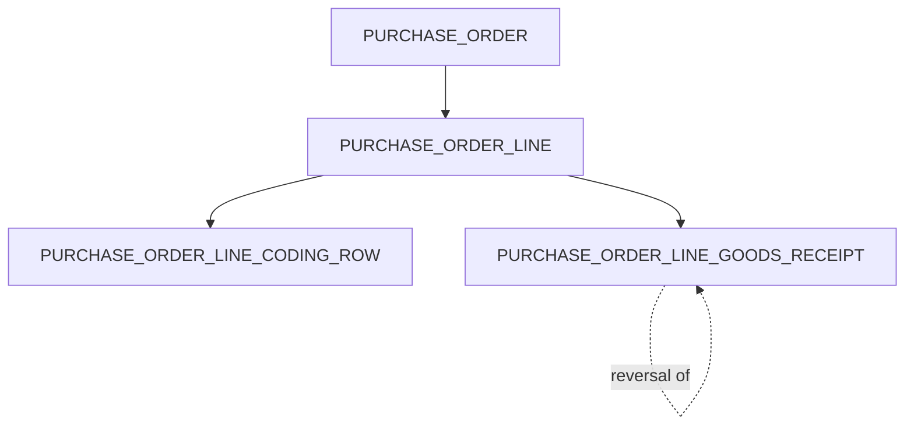

# Purchase Order Data Pipeline

Personal technical exercise: synthetic purchase orders from a file-backed **source API** through **Kafka** to a **target API** (SQLite) and **Snowflake** (RAW → CORE → later dbt), orchestrated by one Airflow DAG.

**Flow:** Source API → Airflow (`purchase_order_pipeline`) → Kafka → Target subscriber → Target API, and in parallel → Snowflake subscriber → RAW → merge → CORE.

## What works now

- Source API (`:8000`): `GET /purchase-orders` (`load_type`, `changed_since`), `/health`
- Kafka (KRaft): `purchase-orders` (3 partitions), `purchase-orders-failed`; UI `:8080`
- Target API (`:8001`): SQLite upsert with `LastUpdated` guard
  - **200** — created/updated
  - **409** — older version rejected (`older_version_rejected`)
- Target subscriber (group `target-api`): PUT → commit on **2xx** or **409**
- Snowflake subscriber (group `snowflake-raw`): land in `RAW.PURCHASE_ORDER_PAYLOADS` (host process; key-pair via `.env`)
- Airflow (`:8081`, `admin`/`admin`): DAG `purchase_order_pipeline`
  - `start` → extract → validate_dedupe → publish → (`wait_for_snowflake_raw` → merge) ∥ `wait_for_target_api` → verify → `end`
  - Param `load_type`: `initial` | `incremental` (incremental always hits the incremental file; watermark adds `changed_since`)
  - Watermark Variable `purchase_order_watermark` set only by `verify`
  - Task logs omit full order payloads (`show_return_value_in_logs=False`)
- SQL under `airflow/dags/sql/` (DDL + RAW→CORE merge)
- Tests: `tests/` (APIs, publish, subscribers) + `airflow/dags/tests/` (DAG graph + sensors); CI: ruff, pytest, gitleaks
- `scripts/publish_initial.py` (pre-Airflow smoke)

## CORE model (overview)



## Setup (macOS)

```bash
cd purchase-order-data-pipeline
python3 -m venv .venv
source .venv/bin/activate
python -m pip install -r requirements.txt
# DAG tests need Airflow (same pin as Compose image):
python -m pip install "apache-airflow==2.10.5" \
  --constraint "https://raw.githubusercontent.com/apache/airflow/constraints-2.10.5/constraints-3.12.txt"
cp .env.example .env   # Kafka + Snowflake
./scripts/check.sh     # ruff + pytest (same gate as CI)
```

## Run the stack

```bash
docker compose up -d --build
# Snowflake subscriber: run on the host (Compose profile needs the key mounted inside the container)
python -m services.snowflake_subscriber.main
```

| Service | URL |
| --- | --- |
| Source API | http://127.0.0.1:8000/health · [docs](http://127.0.0.1:8000/docs) |
| Target API | http://127.0.0.1:8001/health · [docs](http://127.0.0.1:8001/docs) |
| Kafka UI | http://127.0.0.1:8080 |
| Airflow UI | http://127.0.0.1:8081 (`admin` / `admin`) |
| Kafka (host) | `127.0.0.1:9092` (prefer IPv4; `localhost` may hit IPv6 first) |
| Kafka (Compose) | `kafka:29092` |

### Airflow demo

1. Unpause `purchase_order_pipeline`.
2. **Trigger** with conf `{"load_type": "initial"}` → ~100 orders; CORE ≈ **100 / 215 / 275 / 181**.
3. Trigger again with `{"load_type": "incremental"}` → ~18 after dedupe; CORE/target ≈ **104** headers (and **104 / 224 / 286 / 189** after a clean incremental merge).
4. Keep the host Snowflake subscriber running so `wait_for_snowflake_raw` can succeed.

### Smoke (without Airflow)

```bash
curl -s 'http://127.0.0.1:8000/purchase-orders?load_type=initial' \
  | python3 -c 'import json,sys; d=json.load(sys.stdin); print(d["load_type"], d["record_count"])'
python scripts/publish_initial.py
curl -s 'http://127.0.0.1:8001/purchase-orders' \
  | python3 -c 'import json,sys; print("total count:", json.load(sys.stdin)["count"])'
```

`changed_since` is strict greater-than on UTC `LastUpdated`. Source returns the file as-is (including duplicate versions); Airflow `validate_dedupe` keeps the newest per `OrderNumber`.

Synthetic JSON under `data/`. Do not commit `.env` or `rsa_key.*`.

## Still to build

- [ ] dbt MART on CORE (+ `dbt_build` task)
- [ ] ADRs
- [ ] Optional: OpenTelemetry / Kubernetes
