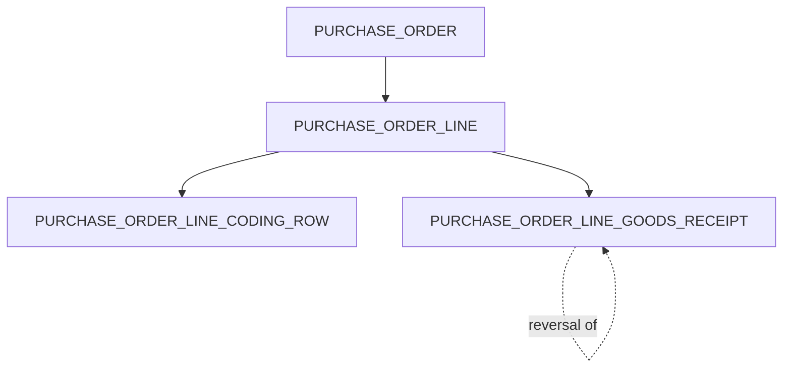

# Purchase Order Data Pipeline

Personal technical exercise: move synthetic purchase orders from a file-backed **source API** through **Kafka** to a **target API** (SQLite) and to **Snowflake** (RAW → CORE → dbt), orchestrated later by one Airflow DAG.

**Flow:** Source API → (publish / later Airflow) → Kafka → Target subscriber → Target API, and in parallel → Snowflake subscriber → RAW → merge → CORE → (later) dbt MART.

## What works now

- Source API (`:8000`): `GET /purchase-orders`, `changed_since`, `/health`
- Kafka (KRaft): topics `purchase-orders` (3 partitions) and `purchase-orders-failed`
- Kafka UI (`:8080`) for topics and consumer groups
- Target API (`:8001`): SQLite upsert with `LastUpdated` guard; `GET` list returns `{count, items}`
  - **200 OK** — applied: `{ "status": "created" | "updated", "order_number", "batch_id" }`
  - **409 Conflict** — older version rejected: `reason` `older_version_rejected`; message like  
    `PO1040000 was not updated: the stored purchase order is newer than the one you sent`
- Target subscriber (group `target-api`): consume → PUT → commit Kafka offset on **2xx** or **409** (both treated as success; 409 is not retried)
- Snowflake subscriber (group `snowflake-raw`): land messages in `RAW`, then SQL merge into the four CORE tables
- Snowflake DDL and merge scripts under `snowflake/`
- `scripts/publish_initial.py`: publish the initial file before Airflow exists
- CI: ruff, pytest, gitleaks

## CORE model (overview)



Order → lines → cost-allocation coding rows and goods receipts (receipts can reverse another receipt).

## Setup (macOS)

```bash
cd purchase-order-data-pipeline
python3 -m venv .venv
source .venv/bin/activate
python -m pip install -r requirements.txt
cp .env.example .env   # Kafka + Snowflake (account, user, key path or password)
ruff check .
pytest -q
```

## Run the stack

```bash
docker compose up -d --build
```

| Service | URL |
| --- | --- |
| Source API | http://127.0.0.1:8000/health · [docs](http://127.0.0.1:8000/docs) |
| Target API | http://127.0.0.1:8001/health · [docs](http://127.0.0.1:8001/docs) |
| Kafka UI | http://127.0.0.1:8080 |
| Kafka (host) | `127.0.0.1:9092` (use IPv4; `localhost` may try IPv6 first) |
| Kafka (in Compose) | `kafka:29092` |

Snowflake subscriber (host; needs `.env`):

```bash
python -m services.snowflake_subscriber.main
# or: docker compose --profile snowflake up -d --build snowflake-subscriber
```

### Smoke checks

```bash
curl -s 'http://127.0.0.1:8000/purchase-orders?load_type=initial' \
  | python3 -c 'import json,sys; d=json.load(sys.stdin); print(d["load_type"], d["record_count"])'

python scripts/publish_initial.py
curl -s 'http://127.0.0.1:8001/purchase-orders' \
  | python3 -c 'import json,sys; d=json.load(sys.stdin); print("total count:", d["count"])'
```

Expect about **100** orders in the target API. Publishing again should not raise the count when `LastUpdated` is unchanged (409 path).

`changed_since` on the source API is strict greater-than on UTC `LastUpdated`. The source API returns the file as-is (including duplicate versions); dedupe belongs in Airflow later.

The JSON under `data/` is synthetic. Do not commit real credentials (`.env` and `rsa_key.*` are gitignored).

## Still to build

- [ ] Airflow DAG `purchase_order_pipeline` (extract → publish → wait → merge → verify)
- [ ] dbt MART on CORE
- [ ] Optional: OpenTelemetry / Kubernetes
